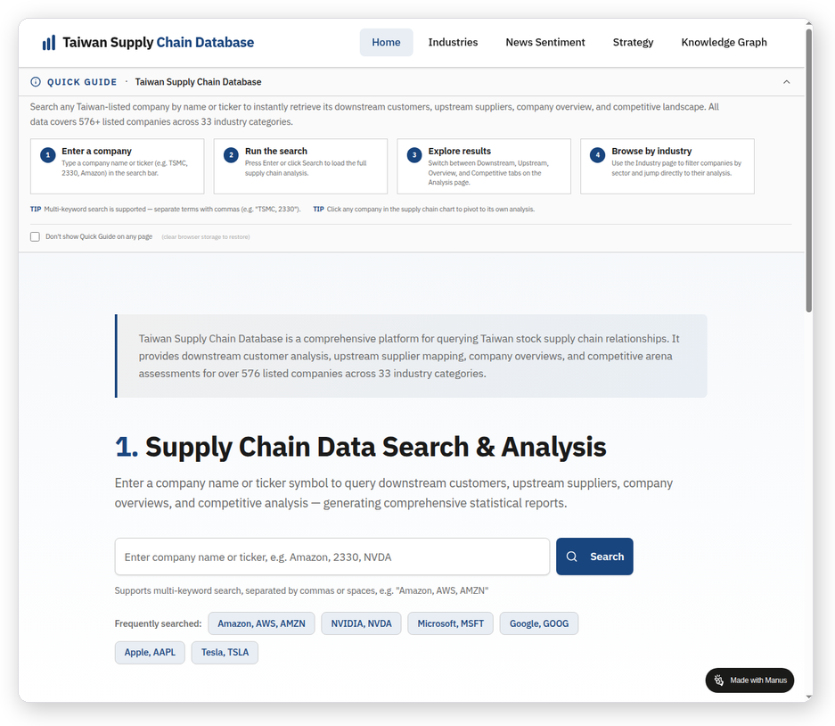
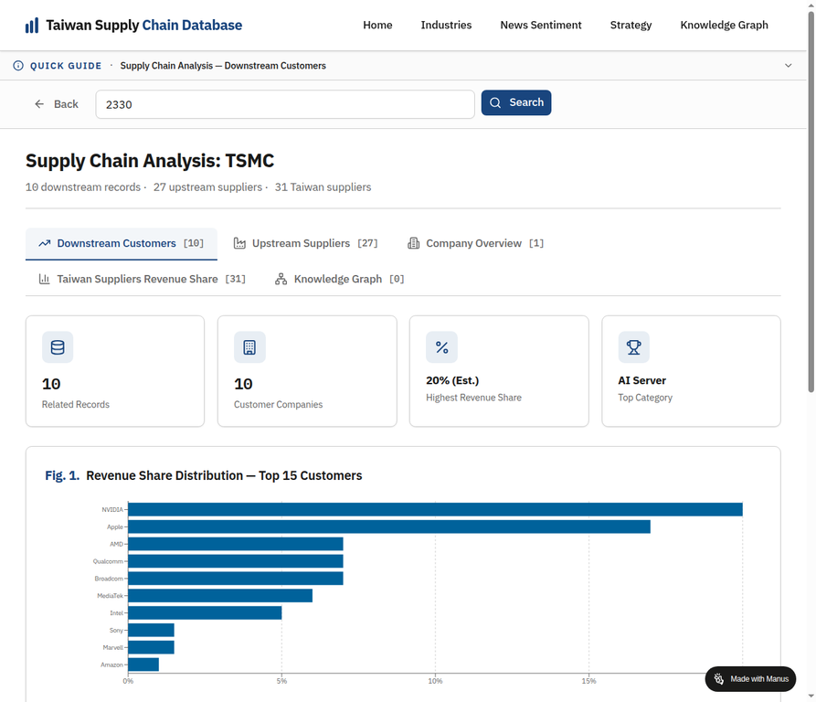
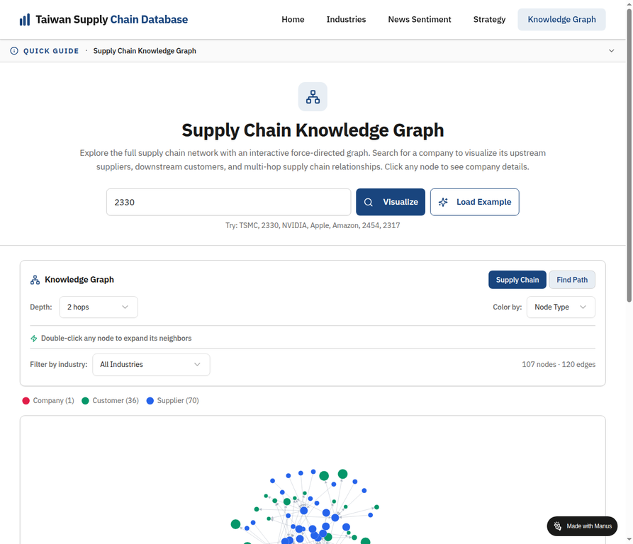
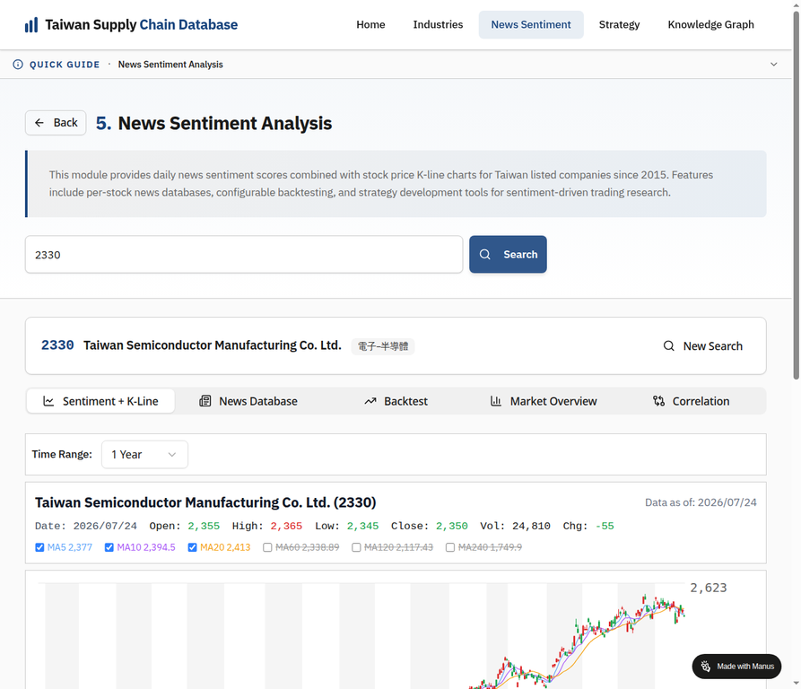
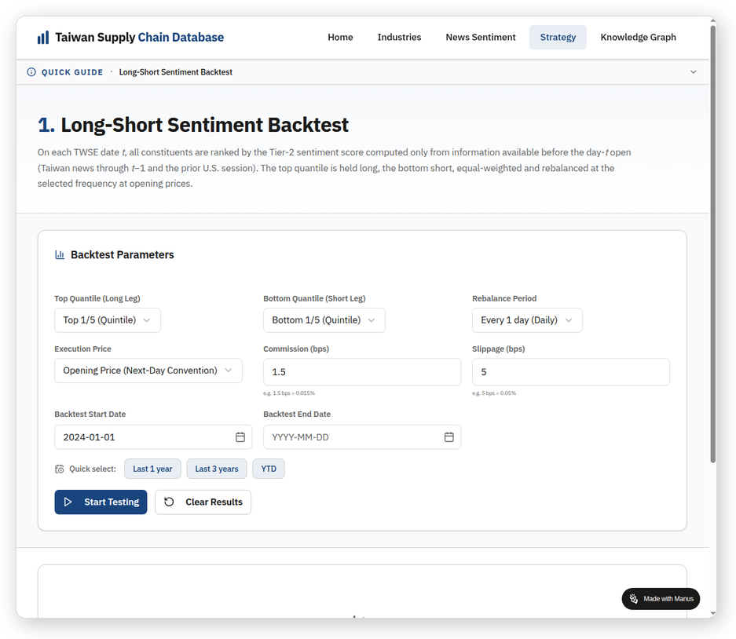
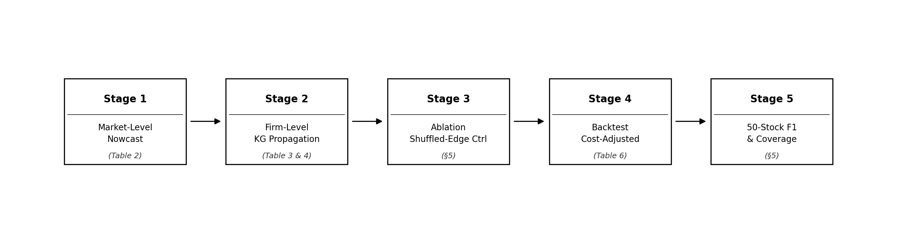

# TWSE-KG

[](https://github.com/tunglich/TWSE-KG/actions/workflows/verify.yml)

An Open-Source Database and Knowledge Graph for Financial News Analysis and Scoring.

## Video Presentation

<p align="center">
  <a href="https://github.com/tunglich/TWSE-KG/raw/main/docs/video/ICAIF_KG_web.mp4" title="Download the ICAIF 2026 presentation (MP4, 48 min)">
    
  </a>
  <br>
  <em>ICAIF 2026 presentation video (MP4, 1280×720, ~48 min, 19 MB). Click the image to download and play.</em>
</p>

## Overview

This repository accompanies the ICAIF 2026 paper

> **Cross-Market Sentiment Propagation via Firm-Level Knowledge Graphs: A Two-Tier Hierarchical Scoring System for Taiwan–U.S. Equities**
> Tung-Li Chen and Jyh-Shing Roger Jang (Department of Computer Science and Information Engineering, National Taiwan University).
> *7th ACM International Conference on AI in Finance (ICAIF '26)*, November 14–17, 2026, Milan, Italy. https://doi.org/10.1145/3858063.3858704

The framework classifies and scores Taiwan and U.S. news, propagates sentiment from named anchor entities to economically
affected Taiwan-listed firms through auditable knowledge-graph (KG) paths, and calibrates Taiwan-side and prior-session U.S.
signals into market- and stock-level scores on a [1, 100] scale:

- **Tier 1 (Market-Level):** fuses the Taiwan market sentiment score with prior-session U.S. news sentiment (β = 0.25 on Taiwan news, 0.75 on U.S. news) into a TAIEX direction score.
- **Tier 2 (Stock-Level):** for each of the 1,179 Taiwan-listed firms, combines the KG-propagated firm Taiwan score (SprintScore), the Tier-1 market score and lagged stock-specific U.S. sentiment under per-stock simplex weights.

The KG snapshot used in the paper (September 30, 2026) contains 8,127 nodes — including 1,179 Taiwan-listed firms — and
40,237 de-duplicated edges (30,942 supplier–customer, 3,704 competitor, 5,591 investee) spanning Taiwan, the United States,
Greater China, Japan, Korea and Europe.

## Knowledge Graph Statistics

| | Paper snapshot<br>(Sep 30, 2026; Table 1(b)) | `data/kg/`<br>Taiwan propagation KG | `data/kg_global/`<br>Multi-market KG |
|---|---:|---:|---:|
| Company nodes | 8,127 | 4,792 | 5,500 |
| &nbsp;&nbsp;of which Taiwan-listed | 1,179 | 1,105 | 1,159 |
| &nbsp;&nbsp;of which other (overseas / unlisted / themes) | 6,948 | 3,687 | 4,341 |
| Supplier → customer edges | 30,942 | 7,377 | 66,351 |
| &nbsp;&nbsp;with both ends resolved to a node | — | 7,377 | 53,575 |
| Competitor edges | 3,704 | 1,725 | 5,272 |
| Investor → investee edges | 5,591 | — | 8,054 |
| **Total edges** | **40,237** | **9,102** | **79,677** |
| Used by the paper's experiments | ✓ | ✓ (propagation input) | — (web application only) |

The paper snapshot counts de-duplicated edges after entity resolution; the released `data/kg_global/` files keep one row per
source-profile entry (supplier lists and customer lists both contribute), so their raw row counts are larger.
See [`data/kg/README.md`](data/kg/README.md) and [`data/kg_global/README.md`](data/kg_global/README.md) for schemas.

## Web Application

The following screenshots illustrate the web application built on top of this pipeline. All pages are publicly accessible without login.

<table>
  <tr>
    <td align="center" width="50%">
      
      <br/>
      <sub><b>Fig. A.</b> Home page — full-text company search across 5,499 companies (1,159 Taiwan-listed firms with supply-chain pages plus overseas companies) with a supply-chain statistics summary.</sub>
    </td>
    <td align="center" width="50%">
      
      <br/>
      <sub><b>Fig. B.</b> Supply Chain Analysis (TSMC, 2330) — downstream customer revenue-share bar chart and ranked customer table.</sub>
    </td>
  </tr>
  <tr>
    <td align="center" width="50%">
      
      <br/>
      <sub><b>Fig. C.</b> Supply Chain Knowledge Graph — interactive firm-centred graph with 2-hop propagation (for TSMC: 256 suppliers, 167 customers, 16 named competitors, 5 investees).</sub>
    </td>
    <td align="center" width="50%">
      
      <br/>
      <sub><b>Fig. D.</b> News Sentiment Analysis — daily Tier-2 sentiment score overlaid on OHLCV K-line chart (TSMC, 2330, 1-year window).</sub>
    </td>
  </tr>
  <tr>
    <td align="center" colspan="2">
      
      <br/>
      <sub><b>Fig. E.</b> Long-Short Sentiment Backtest — configurable quintile-based long-short strategy with commission, slippage, and date-range controls.</sub>
    </td>
  </tr>
</table>

## Pipeline



For the complete mathematical specification (Equations 1–9, parameter table,
notation summary), see [`docs/methodology.md`](docs/methodology.md).

## Repository Structure

```
TWSE-KG/
├── README.md
├── LICENSE                     # MIT License
├── Makefile                    # Pipeline orchestration (make all / verify / smoke)
├── requirements.txt            # Python dependencies
├── smoke_test.py               # Quick sanity check (< 5s)
├── run_experiments.py          # Legacy reproduction script (still works)
├── .github/workflows/
│   └── verify.yml              # CI: auto-verify against paper anchors
├── lib/                        # Reusable library modules
│   ├── anchors.py              #   Paper anchor constants (single source of truth)
│   ├── data.py                  #   Data loading helpers (xlsx accessors)
│   └── metrics.py               #   Verification helpers
├── src/                        # Pipeline stage scripts
│   ├── stage1_market_level.py  #   Tier-1 nowcast/forecast (Table 2)
│   ├── stage2_firm_level.py    #   Tier-2 KG propagation (Tables 3 & 4)
│   ├── stage3_ablation.py      #   Shuffled-edge control ablation (§5)
│   ├── stage4_backtest.py      #   Cost-adjusted backtest (Table 6)
│   └── stage5_50stock.py       #   50-stock F1 gain & coverage (§5)
├── scripts/                    # Utility scripts
│   ├── export_xlsx.py          #   Regenerate Sentiment_score_all.xlsx
│   └── run_ablation_kit.py     #   Run ablation kit selftests
├── data/
│   ├── Sentiment_score_all.xlsx  # All experimental data (7 sheets)
│   ├── kg/                       # Taiwan propagation KG used by the pipeline (refreshed 2026-10-20; see kg/README.md)
│   └── kg_global/                # Multi-market supply-chain KG behind the web app (5,500 companies; not used by the experiments)
├── docs/
│   └── data_schema.md          # Data dictionary for xlsx sheets
└── exp/                        # Ablation kit (shuffled-edge control)
    ├── ABLATION_SPEC.md
    ├── RUNBOOK_SHUFFLED_EDGE.md
    ├── shuffle_control.py
    ├── ablation_design.py
    ├── collect_ablation.py
    └── ...
```

## Quick Start

```bash
# Install dependencies
pip install -r requirements.txt

# Quick smoke test (< 5 seconds)
python smoke_test.py

# Run full pipeline (all 5 stages)
make all

# Or run individual stages
python src/stage1_market_level.py
python src/stage2_firm_level.py
python src/stage3_ablation.py
python src/stage4_backtest.py
python src/stage5_50stock.py

# Verify all numbers against paper anchors
make verify

# Regenerate the xlsx data file
make data

# Run ablation kit selftests
make ablation
```

## Data Description (Sentiment_score_all.xlsx)

| Sheet | Content | Run Script |
|-------|---------|------------|
| Table3_Prediction | Tier-2 same-day F1 for Top-5 companies + Top-50 average | `python src/stage5_50stock.py` |
| Table4_Coverage | Coverage expansion statistics (raw → post-filter → post-KG) | `python src/stage5_50stock.py` |
| Table6_Backtest | Cost-adjusted backtest results (KG vs LLM-Direct vs TAIEX) | `python src/stage4_backtest.py` |
| Ablation_Ladder | 7-rung shuffled-edge control ablation | `python src/stage3_ablation.py` |
| 50_Stock_F1_Coverage | 50-stock individual F1 gain and coverage multiplier | `python src/stage5_50stock.py` |
| Table2_MarketLevel | Tier-1 market-level nowcast/forecast | `python src/stage1_market_level.py` |
| Pipeline_Params | Fixed ex-ante pipeline parameters | `python src/compute_from_csv.py` |

See [docs/data_schema.md](docs/data_schema.md) for full column descriptions.

## Key Results

Held-out window 2024-01-02 – 2026-09-30 (2024–2026Q3); pre-open inputs; Tier-2 target = stock open-to-close direction.

- **F1 lift (Top-50):** 0.5348 (LLM-Direct) → 0.6524 (KG) = +0.1176 (11.8 points); Market-Wide baseline 0.5053
- **Tier 1:** same-day nowcast F1 = 0.7357 (Acc. 68.13%, ROC-AUC 0.7170); next-day forecast F1 = 0.6064 (Acc. 60.64%)
- **Coverage:** 308,994 raw Taiwan articles (2015 – 2026Q3) → 125,714 post-filter → 383,434 firm-level impact records (3.05×); 19.3% of post-KG records fall on Top-50 constituents, 80.7% on other firms
- **Shuffled-edge ablation:** KG exceeds the global shuffle (A1, 0.6138) by +0.0386 F1 (13.8 SD) and the sector-constrained shuffle (A2, 0.6175) by +0.0349 (10.0 SD); the A2 gap is 29.7% of the Direct-to-KG lift
- **Backtest (economic check):** KG long–short (Q1–Q5) 15.4% annualized, net Sharpe 1.18, max drawdown 9.4%, turnover 19%/day; LLM-Direct long–short 6.2%, Sharpe 0.49
- **Robustness:** varying γ, hop limit, frontier cap, λ_s and λ_t one at a time keeps Top-50 F1 within [0.621, 0.662], above LLM-Direct throughout

All values above are those reported in the final paper and are recorded in `lib/anchors.py` (single source of truth for
`run_experiments.py --verify`, `smoke_test.py` and CI). The `50_Stock_F1_Coverage` sheet and the A3/A4 ablation rungs are
from the earlier submitted version and are not reported in the final paper. Re-computing from raw data requires the
pre-scored CSV cache in `data/csv/`, which is not distributed.

## Citation

```bibtex
@inproceedings{chen2026crossmarket,
  author    = {Chen, Tung-Li and Jang, Jyh-Shing Roger},
  title     = {Cross-Market Sentiment Propagation via Firm-Level Knowledge Graphs: A Two-Tier Hierarchical Scoring System for Taiwan--U.S. Equities},
  booktitle = {Proceedings of the 7th ACM International Conference on AI in Finance (ICAIF '26)},
  year      = {2026},
  address   = {Milan, Italy},
  publisher = {ACM},
  doi       = {10.1145/3858063.3858704}
}
```

## License

Code and data: open source under the [MIT License](LICENSE). The paper itself is published under CC BY 4.0.
